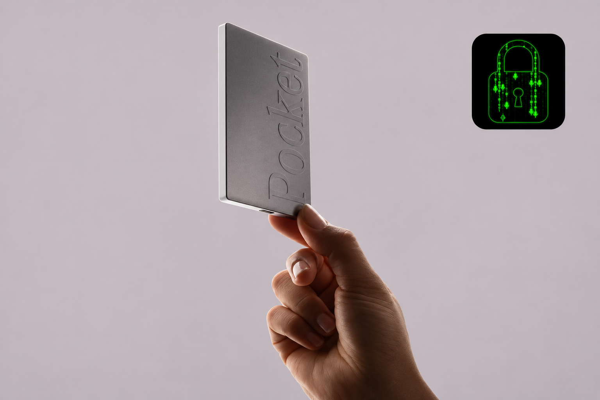

<h1 align="center">Secure Pocket</h1>

<p align="center">
  
</p>
Secure Pocket is an Android companion for the Pocket PKT01 voice recorder. I built it after the product fell short of what I expected. I like the Pocket’s form, but its app left too much to be desired. Key features I wanted were missing or tied to a subscription, and I did not want to rely on Pocket’s servers to handle my recordings.


During a short investigation, I found that the Pocket’s stock firmware leaves Bluetooth Low Energy (BLE) unauthenticated and unencrypted. That became the pathway to Secure Pocket. The app imports Pocket recordings over Bluetooth and gives you more control over processing and storage than Pocket’s app:

- Choose on-phone or self-hosted transcription, or connect another speech-to-text provider.
- Use Docling for self-hosted transcription and summary formatting.
- Use a local, self-hosted, or hosted model to create summaries.
- Edit transcript text and Markdown summaries, and assign speakers to transcript segments (beta).
- Keep your library on your phone or back it up to a computer or NAS you control with Secure Pocket Link or WebDAV.
- Encrypt Link backups with a recovery key you can download and keep.
- Use Secure Pocket without a subscription or Secure Pocket cloud service. Third-party providers you choose may charge fees or process data in their cloud.
- Use the Pocket hardware you paid for without depending on Pocket’s app.

Hosted providers receive the audio or text you send them, depending on the provider and settings.

> **CRITICAL SECURITY FLAW: the Pocket’s Bluetooth connection.** The PKT01’s current firmware does not authenticate or encrypt BLE communications. Someone nearby may be able to intercept traffic or impersonate the recorder. Secure Pocket encrypts data after it reaches the phone and Link protects stored backups, but neither can secure audio on the Pocket or while it travels over BLE.

## Start here

1. Download the latest APK from [Secure Pocket Android releases](releases) to an Android 11+ phone. Open the APK, allow your browser or file manager to install apps if Android asks, then tap **Install** and **Open**.
2. Prepare the Pocket recorder as described below, then connect it in **Device → Connect Pocket**.
3. Set up a summary provider using [the summary guide](#choose-a-summary-provider).
4. Import a recording. Find its audio, transcript, and summary in **Library**.
5. Add Secure Pocket Link only if you want computer or NAS backups. Add Docling only if you want server-side transcription or formatting.

The sections below cover model setup, Link, Docling, storage, and project plans.

### Prepare or reset the Pocket

Before first pairing, factory-reset the Pocket:

1. **Back up anything you want to keep.** Factory reset permanently deletes every recording stored on the Pocket itself.
2. Tap the Pocket’s button three times.
3. Press and hold the button until the LED turns blue.
4. Keep the Pocket near the phone. In Secure Pocket, open **Device → Connect Pocket** and follow the Bluetooth permission prompts.

Resetting the Pocket does not delete the phone’s Secure Pocket library or Link backup.

<details>
<summary>Visual guide</summary>

<p></p>

</details>

## Choose a summary provider

Secure Pocket summarizes new recordings when you select a provider and turn on **Summarize and title new recordings**. Choose a provider in **Settings → Summaries**, then tap **Save settings**.

<details>
<summary>On-device model</summary>

The on-device model keeps transcript text on your phone. Secure Pocket does not include model weights because the available Gemma model has separate license terms.

1. Review and accept the model publisher’s [Gemma terms](https://ai.google.dev/gemma/terms).
2. Download a compatible `.task` file, such as Gemma 3 1B IT INT4, from [LiteRT Community](https://huggingface.co/litert-community/Gemma3-1B-IT/tree/main).
3. In **Settings → Summaries**, choose **On-device LLM → Choose model file** and select the downloaded file.
4. Confirm the selected model name appears, enable **Summarize and title new recordings**, and tap **Save settings**.

</details>

<details>
<summary>OpenAI or OpenRouter</summary>

OpenAI and OpenRouter receive transcript text for summarization. Create an API key with [OpenAI](https://platform.openai.com/api-keys) or [OpenRouter](https://openrouter.ai/settings/keys). In **Settings → Summaries**, choose the provider, enter its API key and a supported model ID, enable **Allow sending text to this provider**, and tap **Save settings**. Keep the key private.

</details>

<details>
<summary>Ollama or another compatible server</summary>

Install Ollama on a computer and download a model with `ollama pull <model-name>`. In **Settings → Summaries**, select **Ollama** and enter the model tag and an HTTPS server URL the phone can reach. For another OpenAI-compatible service, select **Compatible server** and enter its API URL, model ID, and API key. Add `/v1` to the URL if that service requires it. Enable **Allow sending text to this provider**, then save. See [Ollama’s OpenAI-compatible API guide](https://docs.ollama.com/api/openai-compatibility) for server details.

</details>

You can summarize transcripts on the phone or send them to a server. Hosted providers receive the transcript text you choose to process there.

## Add Secure Pocket Link

Secure Pocket Link (Link) runs in the background on Windows, macOS, or Linux and stores encrypted backups on that computer. Choose a local disk or a mounted NAS folder, including a Samba/SMB share. Link has no cloud service, and the phone must be able to reach the computer.

<details>
<summary>Install Link on Windows</summary>

1. Install [Python 3.10 or newer](https://www.python.org/downloads/windows/). Select **Add Python to PATH** during setup.
2. Download and extract the [Secure Pocket source archive](archive/master.zip). Open PowerShell in the extracted project folder, where you’ll find `link-server`.
3. Create Link’s Python environment and install the required packages:

   ```powershell
   py -3 -m venv .venv
   .\.venv\Scripts\python.exe -m pip install -r link-server\requirements-runtime.txt
   ```

4. Start Link in the background and open its settings page:

   ```powershell
   .\link-server\start-link.ps1
   ```

5. In the browser, open **Backup destination**, choose a writable folder, and save. To use an SMB share, map it in File Explorer first and select the mapped folder.

Stop Link with `.\link-server\stop-link.ps1` in PowerShell. Link logs are in `%APPDATA%\secure-pocket-link\link.log` and `link-error.log`.

</details>

<details>
<summary>Install Link on macOS or Linux</summary>

1. Install Python 3.10 or newer. On macOS, use the [Python installer](https://www.python.org/downloads/macos/). On Debian or Ubuntu, run `sudo apt install python3 python3-venv`; on Fedora, run `sudo dnf install python3`; on Arch Linux, run `sudo pacman -S python`.
2. Download and extract the [Secure Pocket source archive](archive/master.zip). Open Terminal in the extracted project folder, where you’ll find `link-server`.
3. Create Link’s Python environment and install the required packages:

   ```sh
   python3 -m venv .venv
   .venv/bin/python -m pip install -r link-server/requirements-runtime.txt
   ```

4. Start Link in the background and open its settings page:

   ```sh
   sh ./link-server/start-link.sh
   ```

5. In the browser, open **Backup destination** and choose a writable folder. To use an SMB share, mount it first. On macOS, connect in Finder with **Go → Connect to Server**; on Linux, use your system’s SMB/CIFS client. Select the mounted folder and save.

Stop Link with `sh ./link-server/stop-link.sh`. Logs are in `~/Library/Application Support/secure-pocket-link/` on macOS or `${XDG_CONFIG_HOME:-~/.config}/secure-pocket-link/` on Linux.

</details>

<details>
<summary>Connect Android to Link</summary>

1. On the Link computer, open `http://127.0.0.1:8733/admin/`. Enter the code from `admin.token` to unlock settings; [find the file here](#find-the-link-settings-unlock-code).
2. Under **Connect the Android app**, configure **Tailscale** with the command shown, or set up a LAN HTTPS route. Link can detect its Tailscale URL when the Tailscale CLI is available. With Docker, copy the URL printed by Tailscale into Link settings.
3. On Android, go to **Settings → Library Location → Secure Pocket Link** and enter Link’s token. For Tailscale-only access, leave **Local URL (preferred)** empty and enter the detected address under **Tailscale URL (fallback)**. To try your LAN first, put its HTTPS address under **Local URL (preferred)** and the Tailscale address under **Tailscale URL (fallback)**. The phone tries the local address first.
4. Tap **Test connection**, then **Save settings**. Turn off **Also keep a copy on this phone** only for server-only imports. The phone must be able to reach Link when importing.

Never enter `127.0.0.1` or a plain `http://` URL on Android. If both URLs are set, the local route’s TLS certificate must match the Tailscale URL hostname. Do not expose Link’s unencrypted API port directly to a LAN or the internet.

</details>

<details id="find-the-link-settings-unlock-code">
<summary>Find the Link settings unlock code</summary>

Desktop installs store the settings unlock code in `admin.token` beside `config.json`. Docker keeps the code in Link’s temporary `/run/link-admin` filesystem, outside the persistent config volume. This code unlocks Link settings; the **Link token** is the separate value used by the Android app. The unlock code changes whenever Link restarts.

| Install | Read the unlock code |
| --- | --- |
| Windows PowerShell | `Get-Content "$env:APPDATA\secure-pocket-link\admin.token"` |
| macOS Terminal | `cat "$HOME/Library/Application Support/secure-pocket-link/admin.token"` |
| Linux terminal | `cat "${XDG_CONFIG_HOME:-$HOME/.config}/secure-pocket-link/admin.token"` |
| Docker Compose | From the folder with `compose.yaml`, run `docker compose exec link cat /run/link-admin/admin.token` |

Enter the code on Link’s settings page from the Link computer. Keep it private.

</details>

<details>
<summary>Back up Link’s encryption key</summary>

Link creates its encryption key in a separate location. In Link settings, choose **Encryption key backup → Download recovery key**. Store the file on separate encrypted storage. Anyone with both the key and library can read the recordings. To move or restore Link, stop it, restore the matching key, `config.json`, and library, then start it again. The [Link recovery guide](link-server/README.md#encryption-key-backup-and-recovery) lists the key locations. Encrypted backups cannot be recovered without the original key.

</details>

<details id="storage-choices">
<summary>Storage choices</summary>

- **Phone:** recordings stay in the Android app’s library.
- **Secure Pocket Link:** Link writes to its selected computer folder or mounted SMB share.
- **WebDAV NAS:** configure the NAS URL and credentials in **Settings → Library Location**. Keep the phone copy enabled if the server-only connection check is unavailable on your device.

Choose one primary library location in the app. Server-only imports need a working connection to the selected server. Android connects directly to WebDAV; mount SMB shares on the computer running Link.

</details>

## Transcription

Secure Pocket includes English Vosk speech-to-text, though its accuracy is limited. For better results, run Docling on a computer or server you control and select **Pre**. Docling will transcribe the recording in place of Vosk. **Settings → Transcription** also offers OpenAI speech-to-text and compatible speech APIs. See the [Docling setup guide](#optional-docling-server-processing). Speaker labeling is still in beta; details are in the [processing guide](docs/PROCESSING.md#names-and-speaker-labels).

## Optional: Docling server processing

Docling can transcribe audio and format summaries. Link uses it for processing; Link’s backup service works independently. Docker Compose builds Link alongside Docling Serve, based on the pinned official CPU image. The image adds upstream Whisper support for transcription and supports x86-64 and ARM64. It does not use Teczone Docling. The first build and transcription may take a while as Docker downloads images and speech models.

Install [Docker Compose](https://docs.docker.com/compose/install/) on the computer or server, then run this from the repository root:

```sh
docker compose up --build -d
```

Open Link settings at `http://127.0.0.1:8733/admin/`, choose a backup destination, and select **Check Docling**. Set up HTTPS for phone access using the [Docker guide](link-server/DOCLING.md#host-folders-and-api-access). In Secure Pocket, go to **Settings → Transcription → Docling formatting**, choose **Pre**, **Post**, or **Both**, enable server processing, and save. Choose a summary provider for **Post** or **Both**. With **Pre**, Docling transcribes the recording, so you do not need a separate speech-to-text provider.

To use a computer folder or NAS share, mount it on the Docker host and follow [the Docker storage guide](link-server/DOCLING.md#host-folders-and-api-access). Back up Link’s key volume separately from its config and library volumes. A Docker administrator can access every mounted volume, so separate volumes do not protect the data if the host is compromised.

## Optional: Tailscale private access

Tailscale gives the phone an HTTPS route to Link without opening a router port. Install [Tailscale on the Link computer](https://tailscale.com/download) and [on Android](https://tailscale.com/docs/install/android), then sign both into the same tailnet. The phone needs Tailscale connected when it uses Link remotely.

With Link running, open a terminal on that computer and run:

```sh
tailscale serve --bg 8732
```

Tailscale Serve prints an HTTPS `*.ts.net` address. Link settings can detect it; tap **Refresh status** if it does not appear. Enter the address in Android’s **Tailscale URL (fallback)** field. Leave **Local URL (preferred)** empty to use Tailscale alone. The `--bg` option keeps Serve running after you close the terminal and brings it back after a reboot or Tailscale restart. Serve works while Tailscale and Link are running. To turn it off, run `tailscale serve --bg 8732 off`. See the [Tailscale Serve guide](https://tailscale.com/docs/reference/tailscale-cli/serve). Tailscale Serve stays within your tailnet; Funnel does not.

## Security and data

Android Keystore keys encrypt the phone library and settings. Link uses AES-GCM for backup bundles and saved secrets, with its encryption key stored separately from config and library data. In readable-folder mode, recording files remain plaintext and rely on encryption provided by the computer or NAS. Separate storage helps if someone gets only the config and library copies; a person with control of the host or Docker can still access the key. Keep a separate recovery-key backup and enable full-disk encryption on the Link host.

**Known hardware limit:** the PKT01’s current firmware does not authenticate or encrypt BLE. Someone nearby may intercept audio or impersonate the recorder. The app cannot change this; resetting the Pocket does not fix it.

**Other trust boundaries:** Compose uses certificate-verified TLS and an API key between Link and Docling. TLS lets Link verify Docling; the API key lets Docling verify Link. They do not use mutual TLS. Processing decrypts audio and text in memory and may write short-lived temporary files. A rooted phone, compromised Link host, Docker administrator, or malicious processing service can access the data available to it. Install `.task` models only from sources you trust; native inference libraries parse these files. Hosted providers receive the audio or text required by the processing option you select. Link limits worker count and idle time, but it does not set a total deadline for slow HTTP headers. Restrict access to the Link API. See [Security and data](docs/SECURITY.md) for the remaining risks and mitigations.

## Planned for the future

- Add Whisper and other transcription services, along with more summary providers.
- Let users choose the default summary prompt or write a custom prompt to shape the format of their summaries.
- Bring the app to desktop and iOS, then publish it through Google Play and the Apple App Store.
- Add live transcription while a recording is underway and the app is open.
- Improve speaker labeling so a few examples from the start of a meeting can help identify speakers later in the transcript.
- Add calendar integration, agentic harness support, and an MCP server.
- Explore custom Pocket firmware with authenticated, encrypted BLE and Wi-Fi transfers directly to Link or the Android app.

## License

Secure Pocket’s original code is licensed under the [MIT License](LICENSE). You can use, copy, modify, reproduce, distribute, sublicense, and sell it under the license terms. Third-party libraries, fonts, speech models, and other assets have their own licenses; check the notices in `third_party/` and each component’s license. Gemma model weights are not included. This project is in no way affiliated with Open Vision Engineering or the Pocket Ai Ecosystem. 

## More information

- [Secure Pocket Link setup, TLS, storage, and executable builds](link-server/README.md)
- [Docker and Docling setup](link-server/DOCLING.md)
- [Processing, transcripts, speakers, and summaries](docs/PROCESSING.md)
- [Security notes](docs/SECURITY.md)
