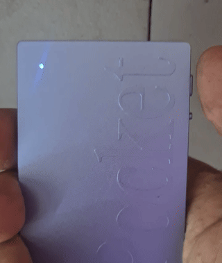

<h1 align="center">Secure Pocket</h1>

<p align="center">
  
</p>
Secure Pocket is an Android companion for the Pocket PKT01 voice recorder. I built it after the product fell short of what I expected. I like the Pocket’s form, but its app left too much to be desired. Key features I wanted were missing or tied to a subscription, and I did not want to rely on Pocket’s servers to handle my recordings.

During a short investigation, I found that the Pocket’s stock firmware leaves Bluetooth Low Energy (BLE) unauthenticated and unencrypted. That became the reason for Secure Pocket. The app imports Pocket recordings over Bluetooth and gives you more control over processing and storage than Pocket’s app:

- Choose on-phone or self-hosted transcription, or connect another speech-to-text provider.
- Use Docling for self-hosted transcription and summary formatting.
- Use a local, self-hosted, or hosted model to create summaries.
- Edit transcript text and Markdown summaries, and assign speakers to transcript segments (beta).
- Keep your library on your phone or back it up to a computer or NAS you control with Secure Pocket Link or WebDAV.
- Encrypt Link backups with a recovery key you can download and keep.
- Use Secure Pocket without a subscription or Secure Pocket cloud service. Third-party providers you choose may charge fees or process data in their cloud.
- Use the Pocket hardware you paid for without depending on Pocket’s app.

Hosted providers receive the audio or text you send them, depending on the provider and settings.

> **CRITICAL SECURITY FLAW: the Pocket’s Bluetooth connection.** The PKT01’s current firmware does not authenticate or encrypt BLE communications. Someone nearby may be able to intercept traffic or impersonate the recorder. Secure Pocket encrypts data after it reaches the phone and Link protects stored backups, but neither can secure audio on the Pocket or while it travels over BLE.

## Start here

1. Download the latest APK from [Secure Pocket Android releases](releases) to an Android 11+ phone. Open the APK, allow your browser or file manager to install apps if Android asks, then tap **Install** and **Open**.
2. Prepare the Pocket recorder as described below, then connect it in **Device → Connect Pocket**.
3. Set up a summary provider using [the summary guide](#choose-a-summary-provider).
4. Import a recording. Find its audio, transcript, and summary in **Library**.
5. Add Secure Pocket Link only if you want computer or NAS backups. Add Docling only if you want server-side transcription or formatting.

Expand a section below for optional model, Link, Docling, storage, and project details.

### Prepare or reset the Pocket

Before first pairing, factory-reset the Pocket:

1. **Back up anything you want to keep.** Factory reset permanently deletes every recording stored on the Pocket itself.
2. Tap the Pocket’s button three times.
3. Press and hold the button until the LED turns blue.
4. Keep the Pocket near the phone. In Secure Pocket, open **Device → Connect Pocket** and follow the Bluetooth permission prompts.

Resetting the Pocket does not delete the phone’s Secure Pocket library or Link backup.

<details>
<summary>Visual guide</summary>

<p></p>

</details>

## Choose a summary provider

New recordings get a summary only when a summary provider is selected and **Summarize and title new recordings** is on. Open **Settings → Summaries**, select a provider, then tap **Save settings**.

<details>
<summary>On-device model</summary>

This keeps transcript text on the phone. Secure Pocket does not include model weights because the available Gemma model has separate license terms.

1. Review and accept the model publisher’s [Gemma terms](https://ai.google.dev/gemma/terms).
2. Download a compatible `.task` file, such as Gemma 3 1B IT INT4, from [LiteRT Community](https://huggingface.co/litert-community/Gemma3-1B-IT/tree/main).
3. In **Settings → Summaries**, choose **On-device LLM → Choose model file** and select the downloaded file.
4. Confirm the selected model name appears, enable **Summarize and title new recordings**, and tap **Save settings**.

</details>

<details>
<summary>OpenAI or OpenRouter</summary>

These hosted options send transcript text to the selected provider. Create an API key with [OpenAI](https://platform.openai.com/api-keys) or [OpenRouter](https://openrouter.ai/settings/keys). In **Settings → Summaries**, select **OpenAI** or **OpenRouter**, enter the API key and a model ID supported by that provider, enable **Allow sending text to this provider**, and tap **Save settings**. Keep the key private.

</details>

<details>
<summary>Ollama or another compatible server</summary>

For Ollama, install it on a computer, download a model with `ollama pull <model-name>`, then select **Ollama** in **Settings → Summaries**. Enter the model tag and an HTTPS server URL reachable from the phone. For another OpenAI-compatible service, choose **Compatible server**, enter its API base URL (including `/v1` when required), model ID, and API key. Enable **Allow sending text to this provider** and save. The phone must be able to reach the service; use HTTPS for network connections. See [Ollama’s OpenAI-compatible API guide](https://docs.ollama.com/api/openai-compatibility) for server details.

</details>

Summary generation can use a local on-device model or a server. When you choose a hosted provider, the transcript text is sent to that provider for processing.

## Add Secure Pocket Link

Secure Pocket Link (Link) is an optional background app. It stores encrypted backups in a folder on a Windows, macOS, or Linux computer. You can choose a local disk or a mounted NAS folder, including Samba/SMB. Link has no cloud service. The Android phone and computer must be able to reach one another.

<details>
<summary>Install Link on Windows</summary>

1. Install [Python 3.10 or newer](https://www.python.org/downloads/windows/). During setup, enable **Add Python to PATH**.
2. Download and extract the [Secure Pocket source archive](archive/master.zip). Open PowerShell in the extracted project folder (the folder containing `link-server`).
3. Create Link’s Python environment and install its dependencies:

   ```powershell
   py -3 -m venv .venv
   .\.venv\Scripts\python.exe -m pip install -r link-server\requirements-runtime.txt
   ```

4. Start Link in the background and open its settings page:

   ```powershell
   .\link-server\start-link.ps1
   ```

5. In the browser, open **Backup destination** and choose a writable folder. For an SMB share, map it in File Explorer first, then select its folder. Save settings.

Stop Link with `.\link-server\stop-link.ps1` in PowerShell. Link logs are in `%APPDATA%\secure-pocket-link\link.log` and `link-error.log`.

</details>

<details>
<summary>Install Link on macOS or Linux</summary>

1. Install Python 3.10 or newer. On macOS, use the [Python installer](https://www.python.org/downloads/macos/). On Debian or Ubuntu, run `sudo apt install python3 python3-venv`; on Fedora, run `sudo dnf install python3`; on Arch Linux, run `sudo pacman -S python`.
2. Download and extract the [Secure Pocket source archive](archive/master.zip). Open Terminal on macOS or a terminal on Linux in the extracted project folder (the folder containing `link-server`).
3. Create Link’s Python environment and install its dependencies:

   ```sh
   python3 -m venv .venv
   .venv/bin/python -m pip install -r link-server/requirements-runtime.txt
   ```

4. Start Link in the background and open its settings page:

   ```sh
   sh ./link-server/start-link.sh
   ```

5. In the browser, open **Backup destination** and choose a writable folder. For an SMB share, mount it first. On macOS, connect in Finder with **Go → Connect to Server**; on Linux, mount it with your system’s SMB/CIFS client. Then choose its mounted folder and save.

Stop Link with `sh ./link-server/stop-link.sh`. Logs are in `~/Library/Application Support/secure-pocket-link/` on macOS or `${XDG_CONFIG_HOME:-~/.config}/secure-pocket-link/` on Linux.

</details>

<details>
<summary>Connect Android to Link</summary>

1. On the Link computer, open `http://127.0.0.1:8733/admin/`. Unlock settings with the code in `admin.token`; see [where to find it](#find-the-link-settings-unlock-code).
2. In **Connect the Android app**, set up **Tailscale** and use the command shown there, or configure a LAN HTTPS route. Link detects the Tailscale URL when it can access the Tailscale CLI. For Docker, paste the URL printed by Tailscale into the editable field.
3. On Android, open **Settings → Library Location → Secure Pocket Link**. Paste Link’s token. For Tailscale only, leave **Local URL (preferred)** blank and put the detected URL in **Tailscale URL (fallback)**. For local-first access, enter your LAN HTTPS URL in **Local URL (preferred)** and the Tailscale URL in **Tailscale URL (fallback)**. The phone tries local first, then Tailscale.
4. Tap **Test connection**, then **Save settings**. Turn off **Also keep a copy on this phone** only if you want server-only imports; Link must be reachable at import time.

Never enter `127.0.0.1` or a plain `http://` URL on Android. If both URLs are set, the local route’s TLS certificate must match the Tailscale URL hostname. Do not expose Link’s unencrypted API port directly to a LAN or the internet.

</details>

<details id="find-the-link-settings-unlock-code">
<summary>Find the Link settings unlock code</summary>

The settings unlock code is stored in `admin.token` beside `config.json`. It is different from the **Link token** you enter on Android, and it changes whenever Link restarts.

| Install | Read the unlock code |
| --- | --- |
| Windows PowerShell | `Get-Content "$env:APPDATA\secure-pocket-link\admin.token"` |
| macOS Terminal | `cat "$HOME/Library/Application Support/secure-pocket-link/admin.token"` |
| Linux terminal | `cat "${XDG_CONFIG_HOME:-$HOME/.config}/secure-pocket-link/admin.token"` |
| Docker Compose | From the folder with `compose.yaml`, run `docker compose exec link cat /config/admin.token` |

Enter the displayed code on the Link settings page on the same computer. Keep it private.

</details>

<details>
<summary>Back up Link’s encryption key</summary>

Link creates its encryption key automatically. In Link settings, use **Encryption key backup → Download recovery key**. Store this file on separate encrypted storage; anyone with the key and Link library can read the recordings. To move or restore Link, stop it and restore the matching key, `config.json`, and library before starting it again. See the [Link recovery guide](link-server/README.md#encryption-key-backup-and-recovery) for file locations. Without the original key, encrypted backups cannot be recovered.

</details>

<details id="storage-choices">
<summary>Storage choices</summary>

- **Phone:** recordings stay in the Android app’s library.
- **Secure Pocket Link:** Link writes to its selected computer folder or mounted SMB share.
- **WebDAV NAS:** configure the NAS URL and credentials in **Settings → Library Location**. Keep the phone copy enabled if the server-only connection check is unavailable on your device.

Choose one primary library location in the app. Server-only imports require an active network connection to the selected server. WebDAV and SMB are different: WebDAV connects from Android; SMB shares should be mounted on the computer running Link.

</details>

## Transcription

Secure Pocket includes English Vosk speech-to-text on the phone, but Vosk is not very accurate. For the best transcription quality, I strongly recommend running a local Docling service on a computer or server you control and selecting **Pre**. This uses Docling to transcribe recordings instead of Vosk. **Settings → Transcription** also offers OpenAI speech-to-text and compatible speech APIs. Configure Docling with [the setup guide](#optional-docling-server-processing). Speaker labeling is a beta feature; read [the processing guide](docs/PROCESSING.md#names-and-speaker-labels).

## Optional: Docling server processing

Docling transcribes audio or formats summaries. It is separate from Link’s backup function. Docker Compose builds Secure Pocket Link beside Docling Serve, using the pinned official CPU image as its base. The Docling image adds upstream Whisper support for audio transcription; it does not use Teczone Docling. It supports x86-64 and ARM64. The first build and transcription can take time to download images and speech models.

You need [Docker Compose](https://docs.docker.com/compose/install/) on the computer or server. From the repository root, run:

```sh
docker compose up --build -d
```

Open Link settings at `http://127.0.0.1:8733/admin/`, choose a backup destination, and use **Check Docling**. Configure HTTPS for phone access as described in the [Docker guide](link-server/DOCLING.md#host-folders-and-api-access). In Android, open **Settings → Transcription → Docling formatting**, select **Pre**, **Post**, or **Both**, enable server processing, and save. Select a summary provider for **Post** or **Both**. **Pre** uses Docling for transcription, so a separate speech-to-text provider is not needed.

For a computer folder or NAS share, mount the share on the Docker host and follow [the Docker storage guide](link-server/DOCLING.md#host-folders-and-api-access). Keep Link’s config volume and library volume backed up together; the config volume contains the encryption key needed to read backups.

## Optional: Tailscale private access

Tailscale provides an HTTPS route to Link without opening a router port or configuring a public reverse proxy. Install [Tailscale on the Link computer](https://tailscale.com/download) and [on Android](https://tailscale.com/docs/install/android), then sign both devices in to the same tailnet. Keep Tailscale connected on the phone when using Link remotely.

With Link running on the computer, open a terminal there and run once:

```sh
tailscale serve --bg 8732
```

Tailscale Serve prints an HTTPS `*.ts.net` address for that computer. Link settings detects this URL; tap **Refresh status** if it does not appear. Enter it in Android’s **Tailscale URL (fallback)** field. Keep **Local URL (preferred)** blank to use Tailscale only. `--bg` keeps Serve running after the terminal closes and restores it after a reboot or Tailscale restart. It is available while Tailscale is connected and Link is running. To disable this Link route, run `tailscale serve --bg 8732 off`. See [Tailscale Serve documentation](https://tailscale.com/docs/reference/tailscale-cli/serve). Do not use Tailscale Funnel; Serve stays within your tailnet.

## Security and data

Link encrypts recordings and settings secrets at rest. Keep its `link.key` with the Link configuration backup; losing the key can make encrypted backups unreadable. Read the [security notes](docs/SECURITY.md) before choosing a storage setup.

The Bluetooth limitation described at the top is part of the PKT01 firmware. App and Link encryption protect data only after it leaves the recorder and while it is stored. A factory reset does not change BLE security.

## Planned for the future

- Add more transcription providers, including Whisper and other speech-to-text services, plus more summary LLM providers.
- Port the Android app to desktop and iOS.
- Publish the Android and iOS apps through Google Play and the Apple App Store.
- Add live transcription while a recording is in progress and the app is open.
- Improve speaker labeling so the app can use a few examples at the start of a meeting to suggest who said later transcript segments.
- Add calendar integration.
- Integrate with agentic harnesses.
- Build an MCP server for Secure Pocket.
- Explore custom Pocket firmware that adds authentication and encryption to BLE communications.
- Explore firmware that lets the Pocket send recordings over built-in Wi-Fi directly to Secure Pocket Link or the Secure Pocket Android app, bypassing BLE for audio transfer.

## License

Original Secure Pocket project code is available under the permissive [MIT License](LICENSE). You may use, copy, modify, reproduce, distribute, sublicense, and sell it, subject to the license terms. Third-party libraries, fonts, speech models, and other assets keep their own licenses; see the notices in `third_party/` and each component’s license. Gemma model weights are not included.

## More information

- [Secure Pocket Link setup, TLS, storage, and executable builds](link-server/README.md)
- [Docker and Docling setup](link-server/DOCLING.md)
- [Processing, transcripts, speakers, and summaries](docs/PROCESSING.md)
- [Security notes](docs/SECURITY.md)
